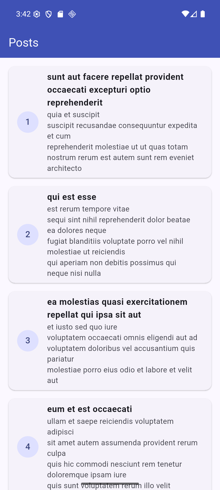

# Лабораторная работа 6. BLoC и HTTP

flutter_bloc, HTTP-запрос к jsonplaceholder.typicode.com/posts, модель Post через json_serializable, состояния Loading / Loaded / Error.

Выполнила: Ильяс Амина

## Запуск

```bash
flutter pub get
flutter run
```

## Скриншот


